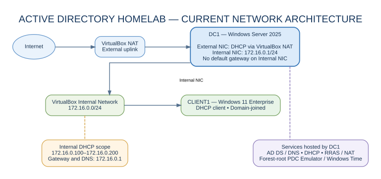

# Environment and Server Configuration

## Purpose

This document summarizes the virtual infrastructure and initial Windows Server configuration used by the Active Directory lab. The environment is hosted in Oracle VirtualBox and contains one domain controller and one Windows client.

## Lab topology



| System | Operating system | Virtual hardware | Network connections |
|---|---|---|---|
| `DC1` | Windows Server 2025 Datacenter Evaluation | 4 GB RAM, 4 vCPU, 50 GB virtual disk | External: VirtualBox NAT; Internal: VirtualBox Internal Network |
| `CLIENT1` | Windows 11 Enterprise Evaluation | 4 GB RAM, 4 vCPU, 80 GB virtual disk | VirtualBox Internal Network |

## Addressing plan

| Interface / service | Configuration |
|---|---|
| DC1 External | DHCP from VirtualBox NAT; address observed during diagnostics was `10.0.2.15` |
| DC1 Internal | Static IPv4 `172.16.0.1/24`; no default gateway |
| Internal subnet | `172.16.0.0/24` |
| DHCP range | `172.16.0.100`–`172.16.0.200` |
| DHCP router / default gateway | `172.16.0.1` |
| DHCP DNS server | `172.16.0.1` |
| Domain | `juancloudsolutions.com` |

The External and Internal interfaces serve different purposes. The External interface connects DC1 to the outside network through VirtualBox NAT. The Internal interface provides the stable address used by domain services and the client network.

## Initial server configuration

The initial server setup included:

- Renaming the Windows Server virtual machine to `DC1`.
- Identifying and renaming its network adapters to `External` and `Internal`.
- Assigning `172.16.0.1/24` to the Internal adapter.
- Leaving the Internal adapter's default gateway empty so that the External interface provides the server's default route.
- Configuring DNS client settings after DNS deployment so both adapters use DC1's Internal address (`172.16.0.1`).

The DNS client settings shown in the early server-configuration screenshots are historical setup evidence. The final configuration was updated during AD DS/DNS troubleshooting; the External adapter's DNS registration is disabled and the DNS Server service listens only on `172.16.0.1`.

## Verification commands

```powershell
# Verify the computer name
hostname

# Inspect the network adapters
Get-NetAdapter

# Inspect the IP configuration
Get-NetIPConfiguration

# Inspect the server's default route
Get-NetRoute -DestinationPrefix "0.0.0.0/0"

# Inspect IPv4 DNS client settings
Get-DnsClientServerAddress -AddressFamily IPv4
```

## Evidence

The original screenshots are preserved in the repository. Selected evidence includes:

- [Network topology source image](../Screenshots/Environment-Setup/01-Network-Topology.png)
- [DC1 virtual machine configuration](../Screenshots/Environment-Setup/02-Server-VM-Configuration.png)
- [CLIENT1 virtual machine configuration](../Screenshots/Environment-Setup/03-Client-VM-Configuration.png)
- [DC1 hostname verification](../Screenshots/Desktop-Experience/Server-Configuration/01-DC1-Hostname-Verification.png)
- [Network adapter identification](../Screenshots/Desktop-Experience/Server-Configuration/02-DC1-Rename-Net-Adapter.png)
- [Internal IPv4 verification](../Screenshots/Desktop-Experience/Server-Configuration/04-DC1-Internal-IP-Verification.png)

See the [complete screenshot index](../Screenshots/README.md) for all 52 images.
