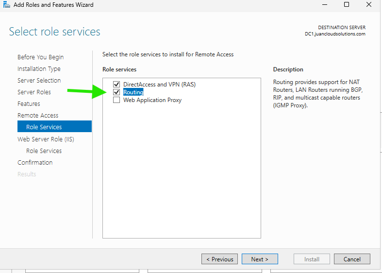
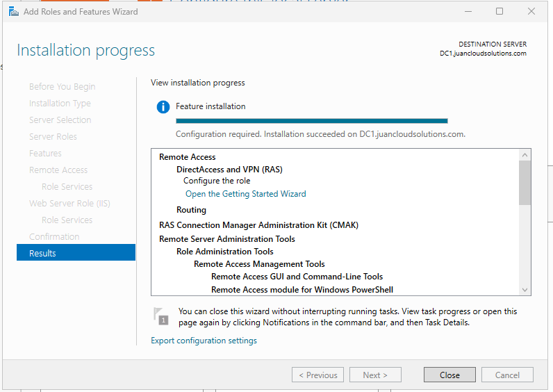
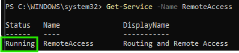
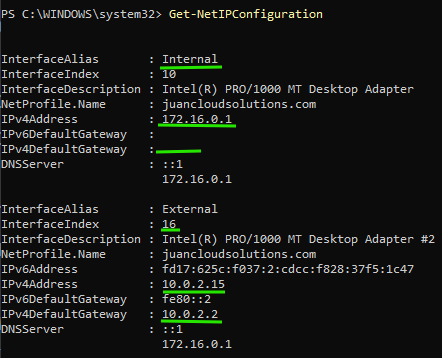
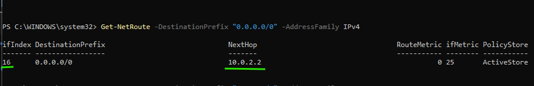

# Routing and Remote Access (RRAS) — NAT Implementation

> **Status: Planned — deployment and verification pending**  
> This document describes the intended RRAS configuration. Update the status and add actual results after the role is installed, NAT is configured, and client connectivity is tested.

## 1. Objective

Configure Routing and Remote Access (RRAS) on DC1 to route outbound traffic from the isolated lab network through the server's External adapter and VirtualBox NAT.

This lab uses the **Remote Access** server role with the **Routing** role service and Network Address Translation (NAT). It does **not** deploy VPN, DirectAccess, or remote-user access. DC1 will act as the default gateway for internal clients and translate their outbound traffic onto its upstream interface.

DHCP will be configured separately in the next implementation phase. It will provide CLIENT1 with the IP address, default gateway, and DNS settings needed to use the route created in this phase.

## 2. Network Design

| Component | Interface / Network | Configuration | Purpose |
|---|---|---|---|
| DC1 External | VirtualBox NAT | DHCP-assigned; previously observed as `10.0.2.15` | Upstream connectivity from DC1 |
| DC1 Internal | VirtualBox Internal Network | Static `172.16.0.1/24`; no default gateway | Gateway for the isolated lab subnet |
| CLIENT1 | VirtualBox Internal Network | DHCP configuration to be applied in the next phase | Windows 11 domain client |

**Planned client network settings (to be distributed by DHCP):**

| DHCP option | Setting | Planned value |
|---|---|---|
| 003 | Default gateway | `172.16.0.1` |
| 006 | DNS server | `172.16.0.1` |
| 015 | DNS domain name | `juancloudsolutions.com` |

The planned DHCP scope is `172.16.0.100`–`172.16.0.200` with subnet mask `255.255.255.0`. These DHCP settings are documented here to explain the intended client route; they will be configured and verified in the separate DHCP phase.

### Expected traffic flow

```text
CLIENT1 (172.16.0.x/24)
        |
        | Default gateway: 172.16.0.1
        v
DC1 — Internal adapter (172.16.0.1/24)
        |
        | RRAS routing and NAT
        v
DC1 — External adapter (VirtualBox NAT; DHCP-assigned)
        |
        | VirtualBox NAT translation
        v
Host network / Internet
```

DC1 will translate traffic from the internal subnet to its External interface. VirtualBox NAT will provide the upstream translation from the VM to the host network. The design therefore uses two NAT stages: RRAS NAT on DC1 and VirtualBox NAT.

The Internal adapter must retain its static address and must not have a default gateway. The External adapter supplies DC1's upstream default route.

## 3. Prerequisites

Before enabling RRAS, verify that:

- DC1 is operating as the domain controller and AD DS/DNS are functioning.
- The External adapter is connected to VirtualBox NAT and DC1 has upstream connectivity.
- The Internal adapter is connected to the VirtualBox Internal Network and uses `172.16.0.1/24`.
- The Internal adapter has no default gateway.
- The External adapter provides the IPv4 default route.
- DNS registration remains disabled on the External adapter, and the DNS Server service remains bound to the intended Internal address.

Review the current network configuration on DC1:

```powershell
Get-NetIPConfiguration
Get-NetRoute -DestinationPrefix "0.0.0.0/0" -AddressFamily IPv4
```

DHCP is not required to install RRAS or configure NAT. It will be needed later for automatic client addressing and for supplying the default gateway and DNS server to CLIENT1.

## 4. Role Installation and RRAS Configuration

### 4.1 Install the Remote Access Routing service

On DC1, use **Server Manager**:

1. Open **Manage** > **Add Roles and Features**.
2. Select **Role-based or feature-based installation** and choose DC1.
3. Select the **Remote Access** server role.
4. In **Role Services**, select **Routing** and install the required management features. The DirectAccess and VPN(RAS) role will be selected automatically upon selected Routing. You may click Next. 
5. Complete the installation and verify that it succeeds.

The Routing role service is the component needed for the lab's router/NAT function. VPN, DirectAccess, and Web Application Proxy are outside the scope of this deployment.





**PowerShell alternative documented by Microsoft:**

```powershell
Install-RemoteAccess -VpnType RoutingOnly
```

This command is an alternative to the Server Manager workflow; record the method actually used when the implementation is complete.

### 4.2 Enable RRAS and configure NAT

After installing the role service:

1. Open **Routing and Remote Access** on DC1.
2. Right-click DC1 and select **Configure and Enable Routing and Remote Access**.
3. Configure the server for NAT/routing for this two-interface lab. Do not enable VPN or dial-up access.
4. In the IPv4 NAT configuration, assign the External and Internal adapters their intended roles.

| Adapter | NAT role | Required setting |
|---|---|---|
| External | Public / upstream interface | Enable NAT on this interface |
| Internal | Private interface | Identify as the private lab network; do not enable it as the public NAT interface |


Verify that the External adapter is selected as the upstream interface and the Internal adapter as the private interface. The External adapter is connected to VirtualBox NAT; it does not have a directly assigned public Internet address.

Do not configure an additional RRAS DHCP allocator or DNS proxy for this phase. The lab will use the Windows DHCP Server role for client leases and the existing AD-integrated DNS service on DC1 for name resolution.

## 5. Verification Plan

Verification will be completed in two stages: RRAS configuration on DC1, followed by end-to-end testing from CLIENT1 after DHCP is deployed.

### 5.1 Verify RRAS on DC1

Confirm that:

- The Remote Access role and Routing service are installed.
- The Routing and Remote Access service is running.
- The IPv4 NAT configuration contains both interfaces.
- External is configured as the public/upstream NAT interface with NAT enabled.
- Internal is configured as the private interface.
- DC1 retains its internal static address and its upstream default route through External.

Useful checks:

```powershell
Get-Service -Name RemoteAccess
Get-NetIPConfiguration
Get-NetRoute -DestinationPrefix "0.0.0.0/0" -AddressFamily IPv4
```




### Initial Routing and Network Configuration Verification

Before configuring RRAS and NAT, I verified the following with the commands above:

- Confirmed that the **Remote Access** service was running.
- Verified that the **Internal** adapter was configured with its static IPv4 address (`172.16.0.1/24`) and had no default gateway.
- Confirmed that the **External** adapter received its IPv4 address (`10.0.2.15`) through VirtualBox NAT.
- Verified that DC1's IPv4 default route was associated with the External adapter.
- Confirmed that the default route pointed to the VirtualBox NAT gateway (`10.0.2.2`).

These checks confirmed that DC1 had the expected network configuration to serve as the routing device between the isolated internal network and the external network.

### Initial Routing and Network Configuration Verification


### 5.2 Verify CLIENT1 after DHCP deployment

Once the DHCP scope and options are configured, renew CLIENT1's lease and inspect its network settings:

```powershell
ipconfig /release
ipconfig /renew
ipconfig /all
```

Confirm that CLIENT1 receives an address in `172.16.0.100`–`172.16.0.200`, subnet mask `255.255.255.0`, default gateway `172.16.0.1`, DNS server `172.16.0.1`, and DNS suffix `juancloudsolutions.com`.

Then test internal connectivity, DNS resolution, and external connectivity separately:

```powershell
# Test connectivity to DC1's Internal adapter
Test-Connection -ComputerName 172.16.0.1 -Count 2

# Test domain DNS resolution through DC1
Resolve-DnsName -Name "juancloudsolutions.com" -Server "172.16.0.1"

# Test external DNS resolution through DC1
Resolve-DnsName -Name "www.microsoft.com" -Server "172.16.0.1" -DnsOnly

# Test outbound HTTPS connectivity
Test-NetConnection -ComputerName "www.microsoft.com" -Port 443
```

A successful DNS lookup alone does not prove that the client can reach the Internet. The outbound TCP test provides a separate connectivity check. Record actual outputs and any failures after testing.

## 6. Success Criteria

| Verification | Expected result | Status |
|---|---|---|
| Remote Access / Routing installation | Completed successfully | Pending |
| RRAS service | Running | Pending |
| External NAT interface | Correctly identified; NAT enabled | Pending |
| Internal NAT interface | Configured as private | Pending |
| DC1 upstream connectivity | Remains functional | Pending |
| CLIENT1 DHCP configuration | Correct address, gateway, and DNS settings | Pending — DHCP phase |
| CLIENT1 internal connectivity | Can reach DC1 | Pending — client validation |
| CLIENT1 external name resolution | Resolves through DC1 | Pending — client validation |
| CLIENT1 outbound connectivity | HTTPS test succeeds | Pending — client validation |

## 7. Troubleshooting Focus

If client connectivity fails, isolate the affected layer rather than assuming every failure is caused by DNS.

| Symptom | Areas to inspect |
|---|---|
| CLIENT1 cannot reach DC1 | VirtualBox Internal Network attachment, DC1 Internal adapter address, and client IP configuration |
| CLIENT1 has an IP address but no external connectivity | DHCP option 003, RRAS NAT interface roles, routing/forwarding, and DC1's External default route |
| CLIENT1 can reach external addresses but cannot resolve names | DHCP option 006, DNS client settings, DC1 DNS service, and DNS forwarding |
| DC1 loses external connectivity after RRAS setup | External default route and confirmation that no default gateway was added to Internal |

## 8. Evidence to Add After Implementation

Capture evidence from the actual configuration after each relevant step. Suggested filenames:

| Filename | Evidence |
|---|---|
| `01-RRAS-Role-Installation.png` | Successful installation of Remote Access and Routing in Server Manager |
| `02-RRAS-Service-Status.png` | RRAS console showing DC1 enabled and the service running |
| `03-RRAS-External-NAT-Configuration.png` | External adapter configured as the public/upstream NAT interface |
| `04-RRAS-Internal-Interface-Configuration.png` | Internal adapter configured as the private interface |
| `05-CLIENT1-DHCP-Configuration.png` | CLIENT1 `ipconfig /all` showing the expected lease, gateway, and DNS settings (after DHCP deployment) |
| `06-CLIENT1-External-Connectivity.png` | Successful outbound HTTPS connectivity test from CLIENT1 (after DHCP deployment) |

Keep screenshots focused on the relevant configuration and output. Redact personal identifiers and any details not needed to demonstrate the implementation.

## 9. Outcome

**Pending implementation and verification.** After completing the RRAS configuration and subsequent CLIENT1 connectivity tests, replace this note with a summary of the installed role service, NAT interface configuration, verification performed on DC1, client connectivity results, and any issues resolved.

Do not mark this phase as completed until the configuration and its verification have actually been performed.

## 10. References

- [Microsoft Learn — Remote Access overview](https://learn.microsoft.com/en-us/windows-server/remote/remote-access/remote-access): Describes the Remote Access role services and the Routing service's NAT capabilities; applies to Windows Server 2025.
- [Microsoft Learn — Install-RemoteAccess cmdlet](https://learn.microsoft.com/en-us/powershell/module/remoteaccess/install-remoteaccess?view=windowsserver2025-ps): Documents the `RoutingOnly` option.
- [Microsoft Learn — Plan the Remote Access infrastructure](https://learn.microsoft.com/en-us/windows-server/remote/remote-access/ras/manage-remote-clients/plan/step-1-plan-the-remote-access-infrastructure): Background on network topology and interface planning.
