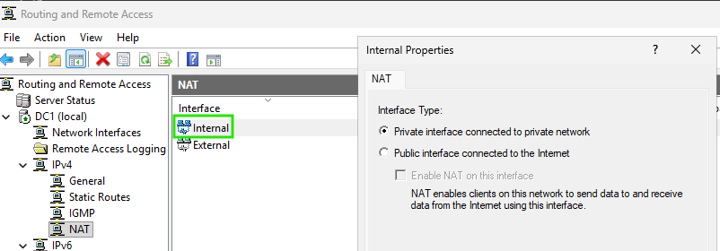
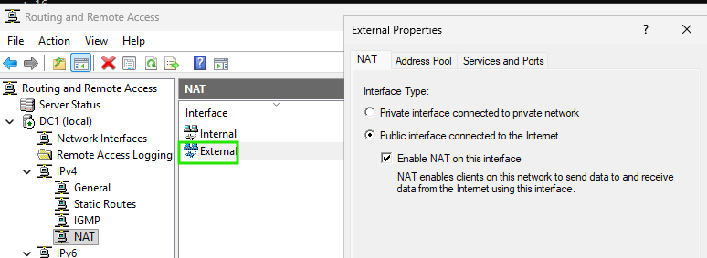
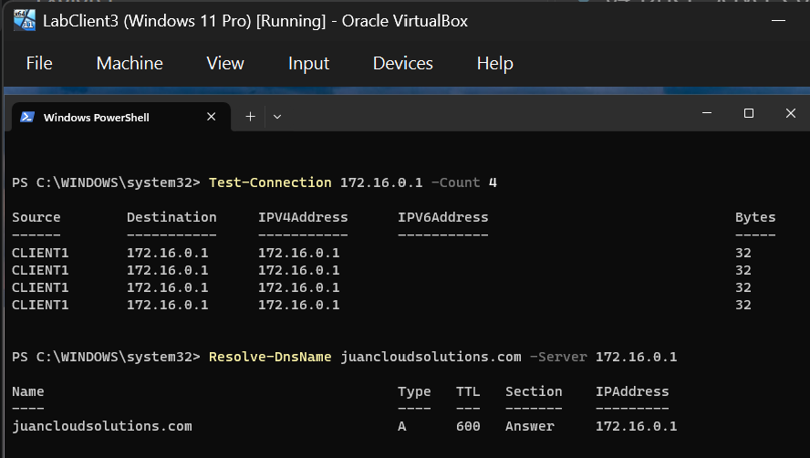
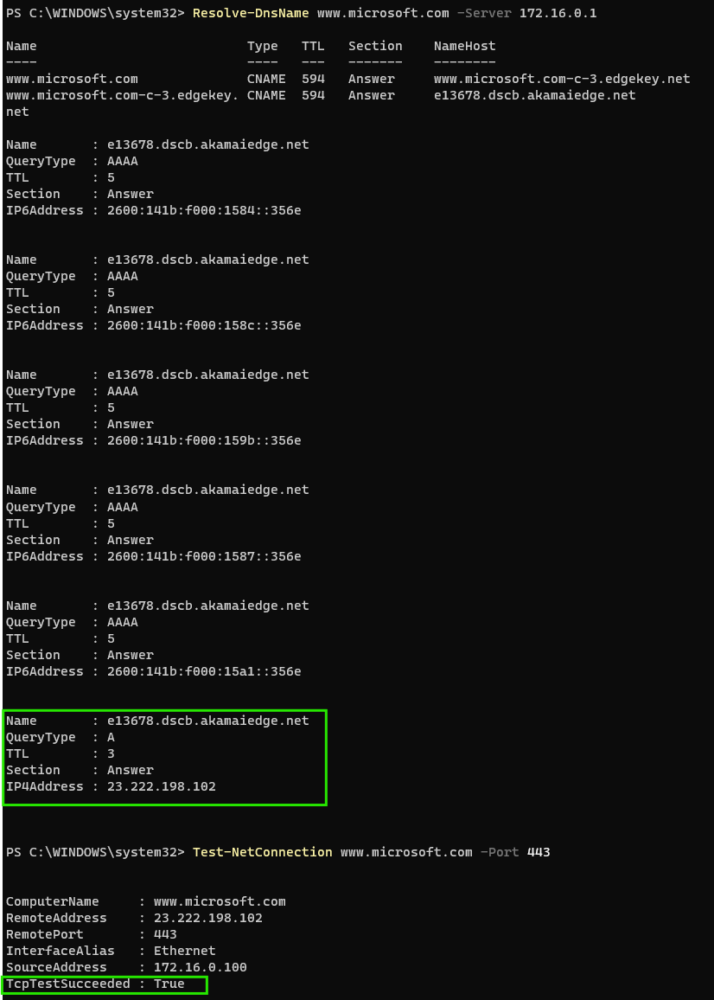

# Routing and Remote Access (RRAS) — NAT Configuration

## Overview

I configured Routing and Remote Access (RRAS) on **DC1**, my Windows Server 2025 domain controller, to provide routing and Network Address Translation (NAT) for the lab's internal network.

DC1 connects the isolated VirtualBox Internal Network to the upstream VirtualBox NAT network. CLIENT1 uses DC1's Internal adapter (`172.16.0.1`) as its default gateway. RRAS translates client traffic through DC1's External adapter, while VirtualBox NAT provides the upstream translation.

This implementation uses the **Routing** role service and NAT. It does not deploy VPN, DirectAccess, or remote-user access.

## 1. Lab Environment and Network Design

I built the lab in Oracle VirtualBox with two virtual machines:

- **DC1:** Windows Server 2025 Datacenter Evaluation (Desktop Experience), configured as the domain controller and RRAS gateway.
- **CLIENT1:** Windows 11 Enterprise Evaluation, connected to the same VirtualBox Internal Network as DC1's Internal adapter.

The Active Directory domain is `juancloudsolutions.com`.

### DC1 network adapters

| Adapter | VirtualBox connection | IPv4 configuration | Purpose |
|---|---|---|---|
| External | NAT | DHCP-assigned; previously observed as `10.0.2.15` | Upstream connectivity |
| Internal | Internal Network | Static `172.16.0.1/24`; no default gateway | Private lab network and client gateway |

The DHCP scope serves the internal `172.16.0.0/24` subnet with addresses from `172.16.0.100` through `172.16.0.200`. DHCP Option 003 provides `172.16.0.1` as the default gateway, and Option 006 provides `172.16.0.1` as the DNS server. The DNS suffix is `juancloudsolutions.com`.

### Client traffic flow

```text
CLIENT1 (172.16.0.x/24)
        |
        | Default gateway: 172.16.0.1
        v
DC1 — Internal adapter (172.16.0.1/24)
        |
        | RRAS routing and NAT
        v
DC1 — External adapter (VirtualBox NAT)
        |
        | VirtualBox NAT translation
        v
Host network / Internet
```

The lab uses two NAT stages:

1. RRAS NAT translates traffic from the internal subnet through DC1's External adapter.
2. VirtualBox NAT provides upstream translation between the External adapter and the host network.

DC1's Internal adapter does not have a default gateway. The upstream IPv4 default route is associated with the External adapter.

## 2. Remote Access Role Installation

I installed the **Remote Access** server role through **Server Manager > Add Roles and Features** and selected the **Routing** role service.

The Routing service provides the routing functionality used in this lab, including support for NAT routers. VPN, DirectAccess, and Web Application Proxy are not part of this implementation.


*Figure 1. Remote Access role and Routing role service installation selections.*


*Figure 2. Remote Access role installation.*

## 3. RRAS and NAT Configuration

After installing the role service, I opened **Server Manager > Tools > Routing and Remote Access** and used the **Configure and Enable Routing and Remote Access** wizard on DC1 to configure the server for routing and NAT.

I configured the two network interfaces according to their roles:

| DC1 adapter | RRAS/NAT role | Configuration |
|---|---|---|
| External | Public / upstream interface | Connected to the VirtualBox NAT network; NAT enabled |
| Internal | Private interface | Connected to the VirtualBox Internal Network (`172.16.0.1/24`) |

### Internal interface

I configured the Internal adapter as the private interface for the lab network. Internal clients use this network to communicate with DC1 and reach the upstream network through RRAS.



*Figure 3. Internal adapter configured as the private network interface.*

### External interface

I configured the External adapter as the public/upstream interface and enabled NAT on it. This interface connects DC1 to VirtualBox NAT; it does not have a directly assigned public Internet address.



*Figure 4. External adapter configured as the upstream interface with NAT enabled.*

## 4. RRAS and Network Configuration Verification on DC1

I used PowerShell to verify the RRAS service state, DC1's network configuration, and the IPv4 default route.

### RRAS service and network adapters

```powershell
Get-Service -Name RemoteAccess

Get-NetIPConfiguration
```

### IPv4 default route

```powershell
Get-NetRoute -DestinationPrefix "0.0.0.0/0" -AddressFamily IPv4
```

The checks confirmed the expected network arrangement:

- The **RemoteAccess** service was running.
- The **Internal** adapter used the static address `172.16.0.1/24` and had no default gateway.
- The **External** adapter received its IPv4 address through VirtualBox NAT. In the captured configuration, the address was `10.0.2.15`.
- DC1's IPv4 default route used the External adapter and the VirtualBox NAT gateway (`10.0.2.2`).


*Figure 5. RRAS service and network adapter status.*


*Figure 6. DC1 network adapter configuration.*


*Figure 7. DC1 IPv4 routing information.*

The RRAS console screenshots in Section 3 show the NAT interface roles, while these PowerShell checks show the service state and underlying network configuration.

## 5. CLIENT1 Connectivity Validation

After configuring DHCP, I tested connectivity from CLIENT1 to DC1 and to external resources. These tests check the client gateway, domain DNS resolution, external DNS resolution through DC1, and outbound HTTPS connectivity.

### Internal gateway and domain DNS

```powershell
# Test reachability of DC1's Internal adapter
Test-Connection 172.16.0.1 -Count 4

# Test domain DNS resolution through DC1
Resolve-DnsName juancloudsolutions.com -Server 172.16.0.1
```



*Figure 8. CLIENT1 gateway reachability and domain DNS resolution tests.*

### External DNS and HTTPS connectivity

```powershell
# Test external DNS resolution through DC1
Resolve-DnsName www.microsoft.com -Server 172.16.0.1

# Test outbound HTTPS connectivity
Test-NetConnection www.microsoft.com -Port 443
```



*Figure 9. CLIENT1 external DNS resolution and outbound HTTPS connectivity tests.*

The DNS query checks whether CLIENT1 can resolve an external hostname through DC1's DNS service. The `Test-NetConnection` command separately tests an outbound TCP connection to port 443.

## 6. Troubleshooting

I use the following checks to isolate routing, NAT, and name-resolution issues.

| Symptom | Areas to inspect |
|---|---|
| CLIENT1 cannot reach DC1 | VirtualBox Internal Network attachment, CLIENT1 IP configuration, and DC1's Internal adapter address |
| CLIENT1 can reach DC1 but cannot access external networks | DHCP Option 003, RRAS NAT interface roles, NAT enablement on External, and DC1's External default route |
| External DNS resolution fails | DHCP Option 006, CLIENT1 DNS settings, the DNS Server service on DC1, and DNS forwarding |
| DC1 loses upstream connectivity | External adapter status, its DHCP-assigned configuration, and the IPv4 default route |
| RRAS service is not running | `Get-Service -Name RemoteAccess` and the Routing and Remote Access console |

## Outcome

I configured RRAS on DC1 with the External adapter serving as the upstream NAT interface and the Internal adapter serving as the private lab network. I verified the RRAS service state and DC1's network configuration, including the upstream default route through VirtualBox NAT.

After implementing DHCP, I also tested CLIENT1's reachability to the internal gateway, domain DNS resolution, external DNS resolution through DC1, and outbound HTTPS connectivity. The corresponding client-side test results are included in Section 5.

## References

- [Microsoft Learn: Remote Access overview](https://learn.microsoft.com/en-us/windows-server/remote/remote-access/remote-access) — Describes the Remote Access role services and the Routing service, including its support for NAT routers.
- [Microsoft Learn: Install-RemoteAccess cmdlet](https://learn.microsoft.com/en-us/powershell/module/remoteaccess/install-remoteaccess?view=windowsserver2025-ps) — Documents the Windows Server 2025 Remote Access PowerShell cmdlet.
