# DHCP Server Configuration

## Overview

I installed and configured the DHCP Server role on **DC1**, my Windows Server 2025 domain controller. The DHCP service provides IPv4 network configuration to clients connected to the lab's internal VirtualBox network.

I configured a DHCP scope for the `172.16.0.0/24` subnet. The scope distributes an IP address, default gateway, DNS server, and DNS domain suffix to clients. DC1's Internal adapter (`172.16.0.1`) serves as the default gateway and DNS server for the internal network.

## 1. Lab Environment and Network Design

I built the lab in Oracle VirtualBox with two virtual machines:

- **DC1:** Windows Server 2025 Datacenter Evaluation (Desktop Experience), configured as the domain controller and DHCP server.
- **CLIENT1:** Windows 11 Enterprise Evaluation, connected to the same VirtualBox Internal Network as DC1's Internal adapter.

The Active Directory domain is `juancloudsolutions.com`.

### DC1 network adapters

| Adapter | VirtualBox connection | IPv4 configuration | Purpose |
|---|---|---|---|
| External | NAT | DHCP-assigned address; previously observed as `10.0.2.15` | Upstream connectivity |
| Internal | Internal Network | Static `172.16.0.1/24`; no default gateway | Domain and client network |

The DHCP scope serves the `172.16.0.0/24` internal subnet. DC1's Internal adapter uses the static address `172.16.0.1`, which is outside the DHCP pool.

### Client traffic flow

1. CLIENT1 obtains its IPv4 configuration from DC1's DHCP service over the Internal Network.
2. CLIENT1 uses `172.16.0.1` as its default gateway.
3. DC1 forwards client traffic through its Routing and Remote Access (RRAS) NAT configuration.
4. DC1's External adapter sends the traffic to the VirtualBox NAT network.

The Internal adapter does not have a default gateway. The upstream default route is configured on DC1's External adapter.

## 2. DHCP Server Role Installation

I installed the DHCP Server role through **Server Manager > Add Roles and Features** and included the DHCP management tools.

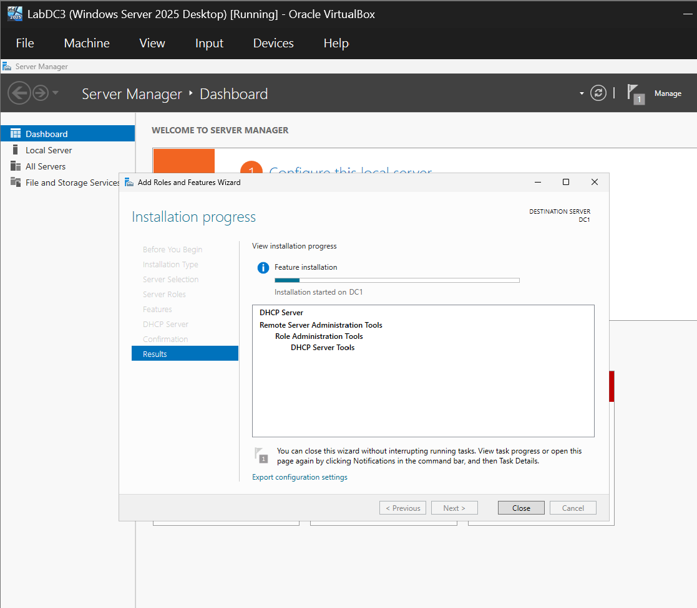

*Figure 1. DHCP Server role and management tools installation.*

After installation, I accessed the DHCP management console from **Server Manager > Tools > DHCP**.

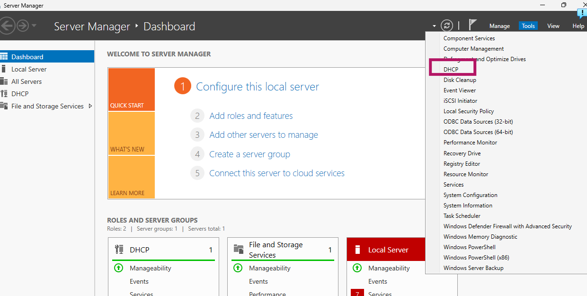

*Figure 2. DHCP management console available from Server Manager's Tools menu.*

### DHCP post-installation configuration

After installing the role, I opened the DHCP Post-Installation Configuration Wizard. The post-installation task creates two security groups for DHCP administration:

- **DHCP Administrators:** Provides permissions to manage DHCP server settings.
- **DHCP Users:** Provides read-only access to DHCP server information.

These groups support delegated administration of the DHCP service.

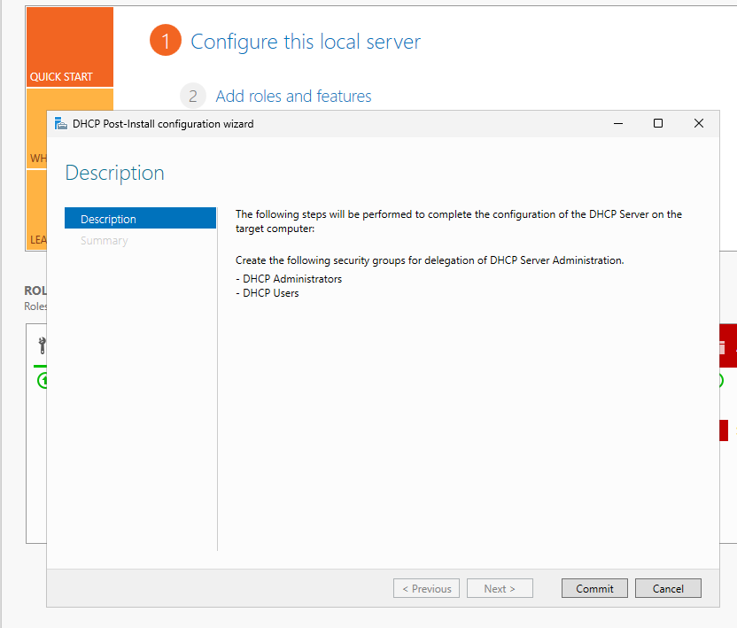

*Figure 3. DHCP Post-Installation Configuration Wizard describing the DHCP Administrators and DHCP Users groups.*

In an Active Directory environment, the DHCP server must also be authorized in Active Directory before it can lease addresses to domain clients. I verify the authorization status as described in Section 5.

## 3. DHCP Scope Configuration

I created an IPv4 scope for the internal VirtualBox network by starting the **New Scope** workflow from the DHCP management console.

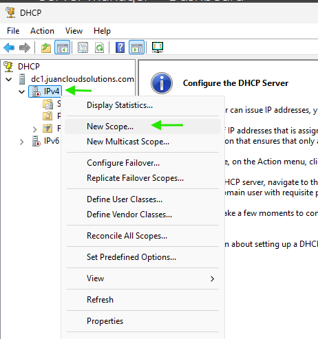

*Figure 4. Starting DHCP scope creation.*

### Scope name

I named the scope `172.16.0.100 - 200` to identify the address range assigned to the internal network.

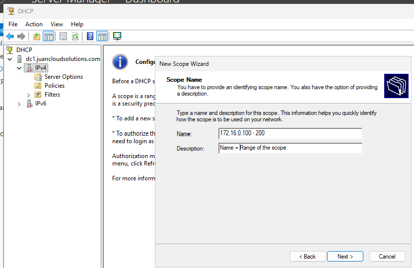

*Figure 5. DHCP scope name and description.*

### Address range and subnet mask

I configured the following IPv4 address range and subnet mask:

| Setting | Configured value |
|---|---|
| Scope ID / subnet | `172.16.0.0` |
| Start address | `172.16.0.100` |
| End address | `172.16.0.200` |
| Subnet mask | `255.255.255.0` |
| Prefix length | `/24` |

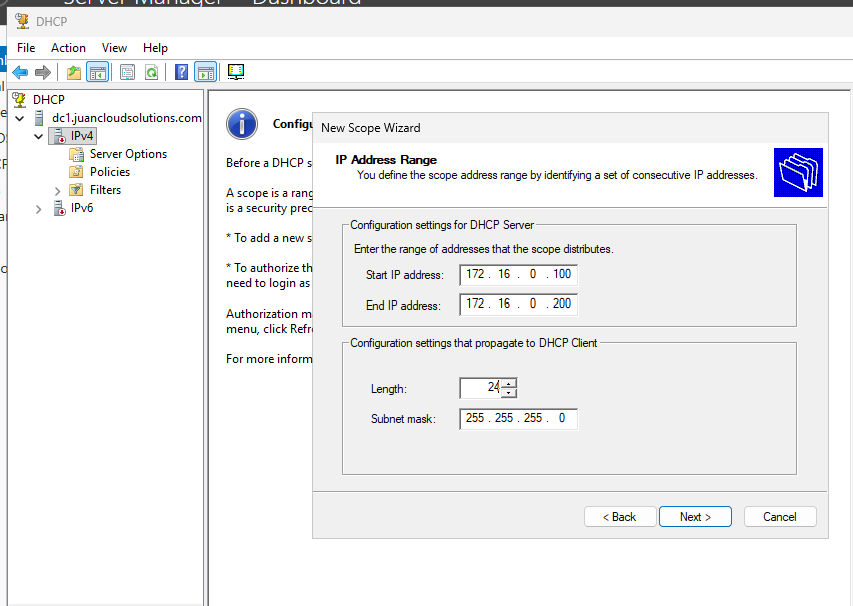

*Figure 6. DHCP scope address range and `/24` subnet mask.*

I selected this range to accommodate the relatively small number of virtual machines and clients expected in the lab. The configured range includes both endpoints, so `172.16.0.100` through `172.16.0.200` provides **101 addresses**.

### Address exclusions and lease duration

I did not configure any address exclusions. DC1's static address (`172.16.0.1`) is outside the dynamic pool and therefore does not need to be excluded.

I configured the DHCP lease duration to **8 days**.

## 4. DHCP Scope Options and Activation

I configured the scope options so DHCP clients receive the network settings required to participate in the domain and communicate beyond the local subnet.

### Default gateway

I configured DHCP Option 003 (Router) with `172.16.0.1`, the IPv4 address assigned to DC1's **Internal** network adapter.

CLIENT1 uses this address as its default gateway when communicating with destinations outside the local subnet. DC1's RRAS/NAT configuration forwards that traffic through its External adapter to the VirtualBox NAT network.

The gateway option is distributed to DHCP clients; it is not configured as a default gateway on DC1's Internal adapter.

I corrected the gateway value in the DHCP scope options and captured an updated screenshot showing `172.16.0.1`.

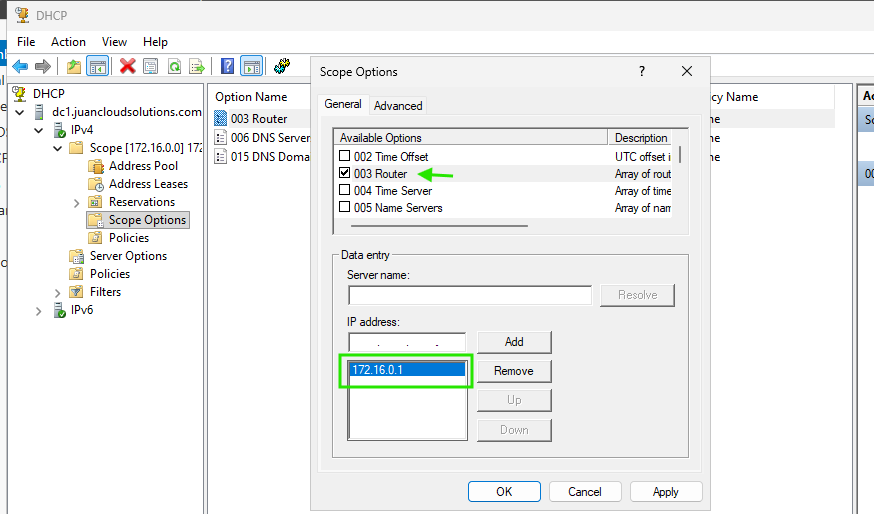

*Figure 7. DHCP Option 003 — Router configured as `172.16.0.1`.*

### DNS settings

I configured the parent DNS domain as `juancloudsolutions.com` and the DNS server address as `172.16.0.1`.

| DHCP option | Configured value | Purpose |
|---|---|---|
| 006 — DNS Servers | `172.16.0.1` | Directs clients to the DNS service on DC1 |
| 015 — DNS Domain Name | `juancloudsolutions.com` | Supplies the domain DNS suffix |
| WINS | Not configured | No WINS server is used in this lab |

These settings direct DHCP clients to the domain controller's DNS service for name resolution.

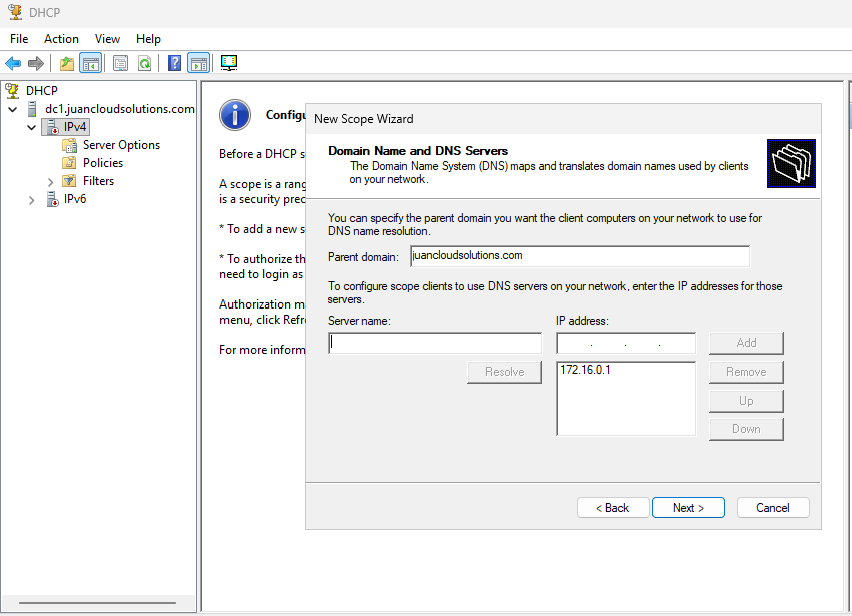

*Figure 8. DHCP parent domain and DNS server configuration.*

### Scope activation

At the end of the scope creation workflow, I selected the option to activate the scope immediately.

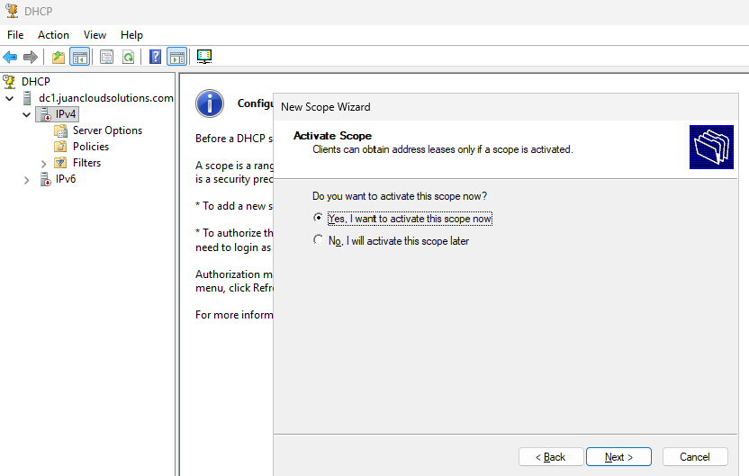

*Figure 9. Activating the DHCP scope during scope creation.*

## 5. DHCP Server Authorization and Interface Binding

### Active Directory authorization

Because DC1 is joined to the Active Directory domain, the DHCP server must be authorized in Active Directory before it can lease addresses to domain clients.

I used the **Authorize** command in the DHCP management console to authorize the server.

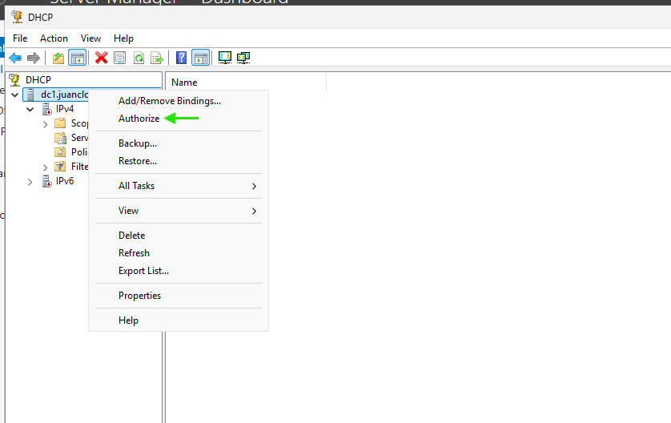

*Figure 10. DHCP server authorization command in the management console.*

I double checked the authorization list with:

```powershell
Get-DhcpServerInDC | Format-Table DnsName, IPAddress
```

DC1 appeared in the returned list with its DHCP server address.

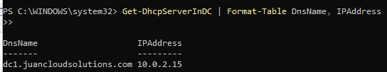

### Network adapter binding

DC1 has both an External and an Internal adapter. I configure DHCP to serve the internal client network rather than the VirtualBox NAT-facing adapter.

In section 6 I inspect the DHCP server's interface bindings with:

```powershell
Get-DhcpServerv4Binding |
    Format-Table InterfaceAlias, IPAddress, BindingState
```
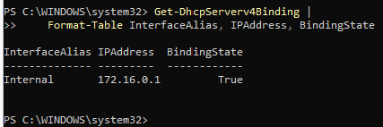


The intended configuration is:

- **Internal:** Enabled (true)
- **External:** Disabled (no returned values)

The External adapter is not returned by the command because DHCP is not bound to it, as intended.

The following commands set the bindings to match the lab design:

```powershell
Set-DhcpServerv4Binding -InterfaceAlias "Internal" -BindingState $true
Set-DhcpServerv4Binding -InterfaceAlias "External" -BindingState $false
```

## 6. DHCP Server and Scope Verification

I use the following PowerShell commands to inspect the DHCP role, service, authorization, interface bindings, scope configuration, options, exclusions, and address utilization.

### Role and service

```powershell
Get-WindowsFeature -Name DHCP

Get-Service -Name DHCPServer
```

### Active Directory authorization

```powershell
Get-DhcpServerInDC |
    Format-Table DnsName, IPAddress
```

### Interface bindings

```powershell
Get-DhcpServerv4Binding |
    Format-Table InterfaceAlias, IPAddress, BindingState
```

### Scope configuration

```powershell
Get-DhcpServerv4Scope -ScopeId 172.16.0.0 |
    Format-List ScopeId, Name, State, StartRange, EndRange,
                SubnetMask, LeaseDuration
```
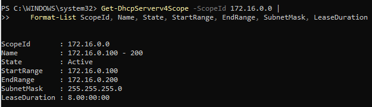

### Scope options

```powershell
Get-DhcpServerv4OptionValue -ScopeId 172.16.0.0 |
    Format-Table OptionId, Name, Value -AutoSize
```
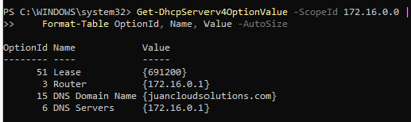

The configured scope options are:

- Option 003 — Router: `172.16.0.1`
- Option 006 — DNS Servers: `172.16.0.1`
- Option 015 — DNS Domain Name: `juancloudsolutions.com`

### Exclusion ranges and scope statistics

```powershell
Get-DhcpServerv4ExclusionRange -ScopeId 172.16.0.0

Get-DhcpServerv4ScopeStatistics -ScopeId 172.16.0.0
```

The DHCP management console displays green status icons for the server and IPv4 node after configuration.

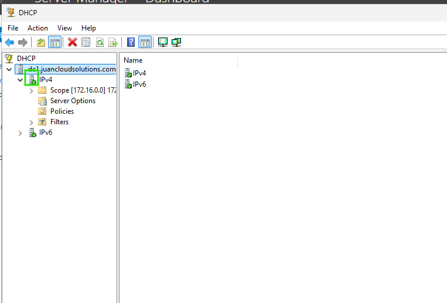

*Figure 11. DHCP management console status following configuration.*

## 7. CLIENT1 Lease and Connectivity Validation

After the DHCP service, scope, authorization, and interface bindings are configured, I validate the client configuration separately.

*Note: CLIENT1 had an APIPA initially, as documented on [CLIENT1 Initial Configuration](../Screenshots/Environment-Setup/07-Client-Initial-IP-Configuration.png).*

### Renew the client lease

On CLIENT1, I run:

```powershell
ipconfig /release
ipconfig /renew
ipconfig /all
```
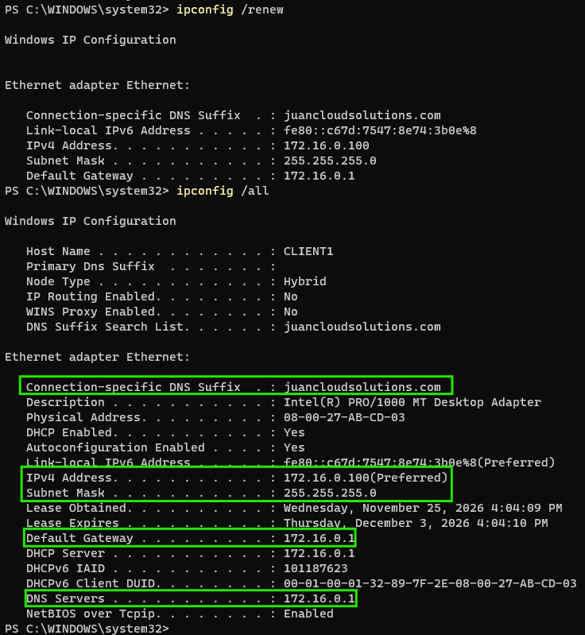

The client configuration shows the intended configuration:

| Setting | Expected value |
|---|---|
| IPv4 address | An available address from `172.16.0.100`–`172.16.0.200` |
| Subnet mask | `255.255.255.0` |
| Default gateway | `172.16.0.1` |
| DNS server | `172.16.0.1` |
| DNS suffix | `juancloudsolutions.com` |

### Review the DHCP lease

After CLIENT1 requests an address, I inspect the lease table on DC1:

```powershell
Get-DhcpServerv4Lease -ScopeId 172.16.0.0 |
    Format-Table IPAddress, HostName, ClientId, AddressState
```

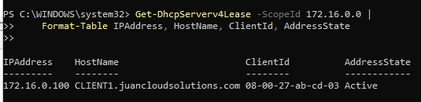

### Test connectivity

I use separate tests to check gateway reachability, DNS resolution, and outbound connectivity:

```powershell
# Test reachability of the internal gateway
Test-Connection 172.16.0.1 -Count 4

# Test DNS resolution using the domain controller
Resolve-DnsName juancloudsolutions.com -Server 172.16.0.1

# Test public DNS resolution through the configured DNS service
Resolve-DnsName www.microsoft.com -Server 172.16.0.1

# Test outbound HTTPS connectivity after RRAS/NAT is configured
Test-NetConnection www.microsoft.com -Port 443
```
**🟢 CLIENT1 Passed all the tests**

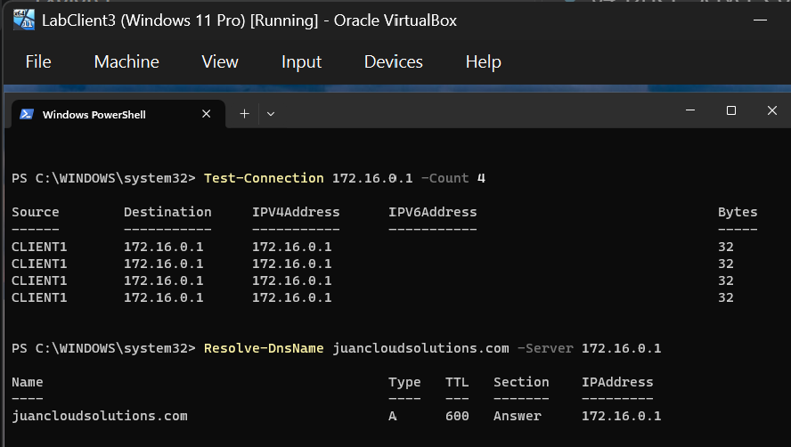
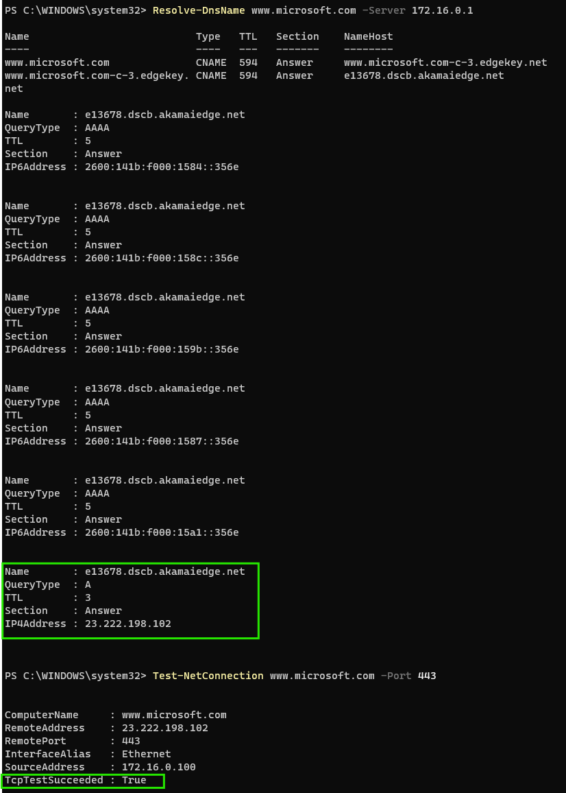

A successful DHCP lease confirms address assignment. Internet connectivity on CLIENT1 also supports RRAS/NAT configuration being operational.

<!-- Suggested evidence to add after completing client validation: a CLIENT1 ipconfig /all screenshot showing its DHCP-assigned address, subnet mask, default gateway, DNS server, and connection-specific DNS suffix. A separate screenshot or command output showing the active DHCP lease on DC1 can document the server-side lease record. -->

## 8. Troubleshooting

| Symptom | Checks |
|---|---|
| CLIENT1 does not receive an IPv4 lease | Confirm the DHCP Server service is running, the scope is active, DC1 is authorized, and the Internal binding is enabled |
| CLIENT1 receives an address outside the expected range | Inspect the active lease and scope configuration; confirm CLIENT1 is connected to the intended VirtualBox Internal Network |
| Default gateway is incorrect | Inspect Option 003  and confirm it is `172.16.0.1` |
| DNS resolution fails | Confirm Option 006 is `172.16.0.1`, then test DNS directly against DC1 |
| Client can reach DC1 but not the internet | Check DC1's External default route and RRAS/NAT configuration |
| DHCP warnings appear in Event Viewer | Review the DHCP Server event log and check authorization, interface binding, and service state |

## 9. Outcome and Next Validation

I configured a DHCP IPv4 scope for the lab's internal `172.16.0.0/24` network. The scope uses the address range `172.16.0.100`–`172.16.0.200`, an eight-day lease duration, no exclusions, and scope options that direct clients to DC1 for gateway and DNS services.

I corrected the DHCP router option to `172.16.0.1` and recaptured the gateway screenshot. The post-installation workflow creates the DHCP Administrators and DHCP Users security groups.

The remaining validation is to confirm the live authorization and interface-binding state, review the scope and option values, and verify that CLIENT1 obtains the expected lease. I will test internet connectivity separately through RRAS/NAT.

## References

- [Microsoft Learn: Install and configure DHCP Server on Windows Server](https://learn.microsoft.com/en-us/windows-server/networking/technologies/dhcp/quickstart-install-configure-dhcp-server)
- [Microsoft Learn: What is DHCP Server in Windows Server?](https://learn.microsoft.com/en-us/windows-server/networking/technologies/dhcp/dhcp-top)
- [Microsoft Learn: DHCP scopes](https://learn.microsoft.com/en-us/windows-server/networking/technologies/dhcp/dhcp-scopes)
- [Microsoft Learn: Deploy DHCP using Windows PowerShell](https://learn.microsoft.com/en-us/windows-server/networking/technologies/dhcp/dhcp-deploy-wps)
- [Microsoft Learn: Active Directory security groups](https://learn.microsoft.com/en-us/windows-server/identity/ad-ds/manage/understand-security-groups)
