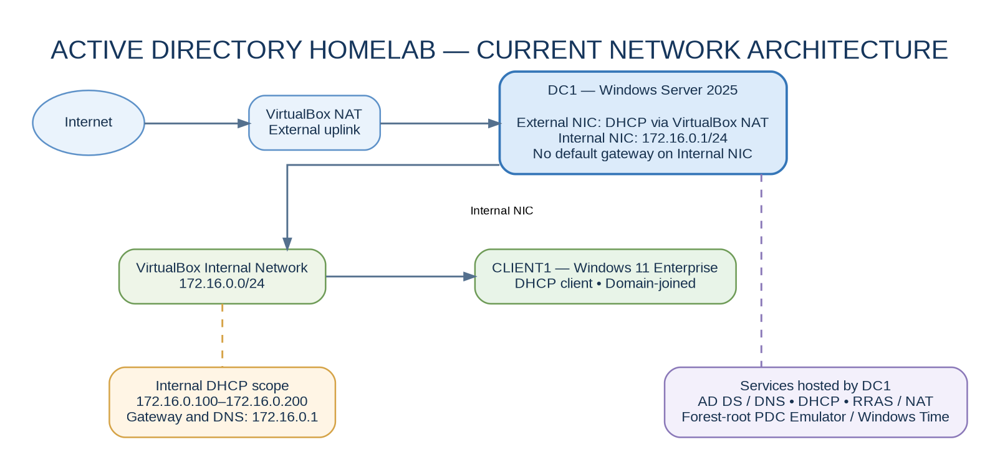

# Active Directory & Windows Infrastructure Homelab

A hands-on Windows infrastructure project built in Oracle VirtualBox to practice deploying, configuring, administering, and troubleshooting a small Active Directory domain environment.

  
  
  
  
  

## Project at a glance

| Metric | Lab result |
|---|---:|
| Virtual machines | 2 |
| Active Directory forest/domain | 1 |
| Domain controller | 1 (`DC1`) |
| Domain-joined Windows client | 1 (`CLIENT1`) |
| DHCP scope | 1 internal IPv4 scope |
| Lab user accounts provisioned in bulk | 1,000+ |

## Explore the project

### 📘 Implementation documentation

1. 🖥️ [Environment and network configuration](Documentation/01-Environment-and-Server-Configuration.md)
2. 🏢 [Active Directory deployment](Documentation/02-Active-Directory-Deployment.md)
3. 🌐 [Routing and Remote Access (RRAS/NAT)](Documentation/03-Routing-and-Remote-Access.md)
4. 📡 [DHCP Server configuration](Documentation/04-DHCP-Server-Configuration.md)
5. 👥 [Identity and account administration](Documentation/05-Identity-and-Account-Administration.md)

### 🧰 Troubleshooting case studies

- 🔎 [DNS registration on a multihomed domain controller](Troubleshooting/01-Multihomed-DNS-Registration.md)
- 🌐 [DNS forwarder reachability and cleanup](Troubleshooting/02-DNS-Forwarder-Reachability.md)
- ⏱️ [Domain controller health and Windows Time](Troubleshooting/03-Domain-Controller-Health-and-Time.md)

### 📂 Evidence and references

- 🖼️ [Screenshot index](Screenshots/README.md)
- 📚 [Microsoft and technical references](References/README.md)

## Overview

The lab simulates a small Windows domain environment with a Windows Server 2025 domain controller and a Windows 11 Enterprise client. DC1 provides Active Directory Domain Services (AD DS), DNS, DHCP, routing/NAT, and domain time services for the isolated internal network.

The project covers both implementation and operational troubleshooting. Work includes deploying a new forest, configuring DNS on a multihomed domain controller, provisioning directory accounts, applying password policies, integrating a Windows client, and validating core services.

## Network architecture

The internal network uses `172.16.0.0/24`. DC1's internal interface is statically configured as `172.16.0.1`; CLIENT1 receives its network configuration from the DHCP scope. The External interface on DC1 connects to VirtualBox NAT for outbound connectivity.

## Environment

| Component | Configuration |
|---|---|
| Virtualization | Oracle VirtualBox |
| Domain controller | `DC1` — Windows Server 2025 Datacenter Evaluation, Desktop Experience |
| Client | `CLIENT1` — Windows 11 Enterprise Evaluation |
| Domain FQDN | `juancloudsolutions.com` |
| NetBIOS domain | `JUANCLOUDSOLUTI` |
| DC1 External NIC | VirtualBox NAT; DHCP-assigned address |
| DC1 Internal NIC | VirtualBox Internal Network; `172.16.0.1/24`; no default gateway |
| DHCP scope | `172.16.0.100`–`172.16.0.200` |
| Client gateway / DNS | `172.16.0.1` |

## Implementation highlights

- Deployed two virtual machines and configured a dual-homed Windows Server domain controller.
- Installed AD DS and DNS, created the `juancloudsolutions.com` forest, and promoted DC1 to a domain controller.
- Configured the DNS zone and controlled DNS registration so that the internal domain publishes DC1's intended internal address.
- Installed and configured DHCP and Routing and Remote Access (RRAS/NAT) to provide automatic client addressing and outbound connectivity.
- Joined CLIENT1 to the domain and verified domain access and network configuration.
- Created and managed organizational units, users, and security groups; performed account lifecycle operations.
- Used an AI-assisted PowerShell workflow to bulk-provision more than 1,000 lab user accounts.
- Configured and applied Active Directory password policies, including Fine-Grained Password Policies.
- Configured DC1 to synchronize with external NIST NTP peers and verified Windows Time health.

## Troubleshooting highlights

| Scenario | Investigation and outcome |
|---|---|
| Multihomed DNS registration | Identified unwanted records from DC1's External interface, disabled its DNS registration, restricted DNS listening to the Internal IPv4 address, and verified the authoritative host record. |
| DNS forwarder reachability | Tested both forwarders over UDP and TCP; removed an unreachable IPv6 forwarder and retained the working IPv4 forwarder. |
| Domain controller time | Identified that DC1 was using its local clock, configured external NTP peers on the forest-root PDC Emulator, and verified successful synchronization. |
| Domain controller health | Used `dcdiag`, service checks, and share verification to assess AD DS, DNS, SYSVOL, and Netlogon availability. |

## Tools and technologies

**🪟 Windows infrastructure:** Windows Server 2025, Windows 11 Enterprise, AD DS, DNS Server, DHCP Server, RRAS/NAT, Windows Time.

**⚙️ Administration and troubleshooting:** PowerShell, Active Directory Users and Computers, Server Manager, `dcdiag`, `Resolve-DnsName`, `nslookup`, and `w32tm`.

**💻 Virtualization and documentation:** Oracle VirtualBox, Git, GitHub, Markdown.

## Scope and design notes

- This is a self-directed virtual lab, not a production deployment.
- The environment uses one domain controller and one Windows client; multi-domain-controller replication is outside the current scope.
- The AD DS forest was deployed through Server Manager and the AD DS Configuration Wizard. The PowerShell script generated by the wizard was reviewed as a learning reference, not executed to perform the promotion.
- AI tools assisted with development of the bulk-account provisioning workflow; the workflow was used against lab test accounts.
- The supplied project archive contained inline PowerShell examples but no standalone `.ps1` files. Reusable scripts can be added as they are cleaned, reviewed, and published separately.
- The separate Windows Server Core learning track is maintained outside this portfolio snapshot.

## 🧭 Future extensions

Potential next steps include a separate Server Core AD DS deployment, Group Policy design, file shares and NTFS permissions, additional domain controllers, and hybrid identity exploration with Microsoft Entra ID.
